# Khmer event template pack — catalogue

The 100 pack templates, served from `/assets/template-pack/` and listed by the
Template Studio under **Event designs**. Every entry is a native invitation
document (`schemaVersion` 1) built by `tools/build-template-pack.py` from
`template-pack/`; the picker never imports the pack into the editor bundle.

- Source of truth: `template-pack/catalog.json` (copy, palettes, pages) and the
  per-template layer files under `template-pack/templates/`.
- Rebuild: `.venv/bin/python tools/build-template-pack.py`
- Verify: `.venv/bin/python tools/build-template-pack.py --check` and
  `.venv/bin/python -m pytest tests/test_template_pack.py -q`
- Thumbnails: `assets/template-pack/thumbs/<id>.webp`, 420 px wide, rendered in
  the real editor by `tools/render-template-thumbs.py`.
- Acceptance evidence: [ACCEPTANCE-2026-10-25.md](ACCEPTANCE-2026-10-25.md),
  [DESIGN-REVIEW-2026-10-25.md](DESIGN-REVIEW-2026-10-25.md),
  [PUBLIC-PROOF-2026-10-25.md](PUBLIC-PROOF-2026-10-25.md) and the
  [final report](FINAL-REPORT-2026-10-25.md).

Canvas codes: `a5p` = A5 portrait 1000×1414; `story` = 1080×1920 story;
`square` = 1080×1080; `portrait` = 1080×1350; `a4p` = A4 portrait 1240×1754.

## The 100

| # | Thumbnail | Template | Category | Canvas | Pages | Text objects | Ornaments | Typography | Opening scene | Style kit | Tags |
|---|---|---|---|---|---|---|---|---|---|---|---|
| 1 |  | **Royal Maroon & Gold** អាពាហ៍ពិពាហ៍ ក្រហមមាស `wd-royal-maroon-gold` | Wedding | A5 portrait (1000×1414) | 2 | 34 | 0 | ceremonial | `silk-curtain` | `royal-khmer-gold` | wedding, traditional, royal, dark, gold |
| 2 |  | **Ivory Kbach Frame** អាពាហ៍ពិពាហ៍ ស៊ុមក្បាច់ខ្មែរ `wd-ivory-kbach-frame` | Wedding | A5 portrait (1000×1414) | 1 | 16 | 0 | ceremonial | `silk-curtain` | `royal-khmer-gold` | wedding, traditional, light, gold |
| 3 |  | **Lotus Watercolour** អាពាហ៍ពិពាហ៍ ផ្កាឈូកទន់ភ្លន់ `wd-lotus-watercolour` | Wedding | A5 portrait (1000×1414) | 1 | 17 | 0 | elegant | `floral-reveal` | `botanical-blush` | wedding, soft, pink, watercolour, light |
| 4 |  | **Midnight Navy & Gold** អាពាហ៍ពិពាហ៍ ខៀវយប់ និងមាស `wd-midnight-navy-gold` | Wedding | A5 portrait (1000×1414) | 1 | 16 | 0 | elegant | `silk-curtain` | `royal-khmer-gold` | wedding, modern, dark, gold, navy |
| 5 |  | **Temple Arch** អាពាហ៍ពិពាហ៍ ក្លោងទ្វារប្រាសាទ `wd-temple-arch` | Wedding | A5 portrait (1000×1414) | 1 | 13 | 0 | ceremonial | `silk-curtain` | `royal-khmer-gold` | wedding, traditional, temple, angkor, warm |
| 6 |  | **Quiet Ivory** អាពាហ៍ពិពាហ៍ ស្អាតសាមញ្ញ `wd-quiet-ivory` | Wedding | 4:5 portrait (1080×1350) | 1 | 16 | 0 | modern | `soft-monogram` | `botanical-blush` | wedding, minimal, modern, light |
| 7 |  | **Jade Garden** អាពាហ៍ពិពាហ៍ សួនបៃតង `wd-jade-garden` | Wedding | A5 portrait (1000×1414) | 1 | 16 | 0 | elegant | `floral-reveal` | `botanical-blush` | wedding, green, garden, light, elegant |
| 8 |  | **Saffron Sunrise** អាពាហ៍ពិពាហ៍ ថ្ងៃរះ `wd-saffron-sunrise` | Wedding | A5 portrait (1000×1414) | 1 | 15 | 0 | elegant | `floral-reveal` | `botanical-blush` | wedding, warm, sunrise, orange, traditional |
| 9 |  | **Red & Gold Story** អាពាហ៍ពិពាហ៍ ក្រហម និងមាស `wd-red-gold-story` | Wedding | Story 9:16 (1080×1920) | 1 | 16 | 0 | ceremonial | `silk-curtain` | `royal-khmer-gold` | wedding, red, gold, story, phone, traditional |
| 10 |  | **Save the Date** កត់ទុកថ្ងៃ ផ្កាឈូកខ្ចី `wd-save-the-date` | Wedding | Square 1:1 (1080×1080) | 1 | 16 | 0 | modern | `soft-monogram` | `botanical-blush` | wedding, save-the-date, minimal, engagement, square |
| 11 |  | **Hair-Cutting Blessing** កាត់សក់ ផ្កាឈូកទន់ភ្លន់ `wd-hair-cutting` | Wedding | A5 portrait (1000×1414) | 1 | 15 | 0 | elegant | `floral-reveal` | `botanical-blush` | wedding, hair-cutting, ceremony, gold, soft |
| 12 |  | **Dark Plum Reception** ជប់លៀង ខ្មៅស្វាយ និងមាស `wd-reception-dark-plum` | Wedding | 4:5 portrait (1080×1350) | 1 | 16 | 0 | elegant | `silk-curtain` | `royal-khmer-gold` | wedding, reception, dark, gold, evening |
| 13 |  | **Photo Modern** អាពាហ៍ពិពាហ៍ ទំនើប `wd-photo-modern` | Wedding | 4:5 portrait (1080×1350) | 1 | 13 | 0 | modern | `floral-reveal` | `botanical-blush` | wedding, photo, modern, light |
| 14 |  | **Three-Day Programme** កម្មវិធីបីថ្ងៃ បែបប្រពៃណី `wd-three-day-program` | Wedding | A5 portrait (1000×1414) | 1 | 18 | 0 | ceremonial | `soft-monogram` | `botanical-blush` | wedding, programme, schedule, traditional |
| 15 |  | **First Birthday Pastel** ខួបកំណើតគម្រប់ ១ ឆ្នាំ ពណ៌ទន់ `bd-first-pastel` | Birthday | 4:5 portrait (1080×1350) | 1 | 12 | 0 | festive | `floral-reveal` | `botanical-blush` | birthday, first, kids, pastel |
| 16 |  | **Kids Party** ជប់លៀងកុមារ ពណ៌ដិតដាស់ `bd-kids-party` | Birthday | Square 1:1 (1080×1080) | 1 | 12 | 0 | festive | `floral-reveal` | `botanical-blush` | birthday, kids, party, bold |
| 17 |  | **Golden Soirée** ខួបកំណើត ខ្មៅ និងមាស `bd-golden-soiree` | Birthday | 4:5 portrait (1080×1350) | 1 | 13 | 0 | elegant | `cinematic-photo` | `modern-cambodian-luxury` | birthday, adult, dark, gold, elegant |
| 18 |  | **Longevity Blessing** ចម្រើនអាយុ មាសព្រះអាទិត្យ `bd-longevity-60` | Birthday | A5 portrait (1000×1414) | 1 | 13 | 0 | ceremonial | `minimal-editorial` | `modern-cambodian-luxury` | birthday, longevity, elder, respectful, traditional |
| 19 |  | **Modern Bold** ខួបកំណើត ពណ៌ដិតដាស់ `bd-modern-bold` | Birthday | 4:5 portrait (1080×1350) | 1 | 13 | 0 | modern | `cinematic-photo` | `modern-cambodian-luxury` | birthday, modern, minimal, adult |
| 20 |  | **House Blessing** ឡើងផ្ទះថ្មី ផ្កាឈូកទន់ភ្លន់ `hw-housewarming` | Ceremony | A5 portrait (1000×1414) | 1 | 12 | 0 | elegant | `minimal-editorial` | `modern-cambodian-luxury` | housewarming, blessing, ceremony, warm |
| 21 |  | **Merit-Making** បុណ្យទាន បែបប្រពៃណី `merit-dana` | Ceremony | A5 portrait (1000×1414) | 1 | 13 | 0 | ceremonial | `minimal-editorial` | `modern-cambodian-luxury` | merit, dana, buddhist, respectful, traditional |
| 22 |  | **Kathina Robe Offering** កឋិនទាន ពណ៌ទឹកក្រូច `kathina-robe` | Ceremony | A5 portrait (1000×1414) | 1 | 13 | 0 | ceremonial | `minimal-editorial` | `modern-cambodian-luxury` | kathina, buddhist, saffron, dark, respectful |
| 23 |  | **Pchum Ben** ភ្ជុំបិណ្ឌ បែបប្រពៃណី `pchum-ben` | Ceremony | 4:5 portrait (1080×1350) | 1 | 14 | 0 | elegant | `minimal-editorial` | `modern-cambodian-luxury` | pchum-ben, ancestors, buddhist, sober, respectful |
| 24 |  | **Memorial Ceremony** បុណ្យខួប ស្ងប់ស្ងាត់ `memorial-ceremony` | Ceremony | A5 portrait (1000×1414) | 1 | 14 | 0 | elegant | `minimal-editorial` | `modern-cambodian-luxury` | memorial, sober, respectful, monochrome |
| 25 |  | **Khmer New Year** ចូលឆ្នាំថ្មី ភ្លឺថ្លា `gr-khmer-new-year` | Greetings | Square 1:1 (1080×1080) | 1 | 6 | 0 | festive | `floral-reveal` | `botanical-blush` | greeting, khmer-new-year, festive, warm |
| 26 |  | **Water Festival** បុណ្យអុំទូក ទន្លេខៀវ `gr-water-festival` | Greetings | Banner 16:9 (1600×900) | 1 | 4 | 0 | festive | `floral-reveal` | `botanical-blush` | greeting, water-festival, festive, blue, landscape |
| 27 |  | **Global New Year** ឆ្នាំសកល ខៀវចាស់ និងមាស `gr-global-new-year` | Greetings | Story 9:16 (1080×1920) | 1 | 4 | 0 | festive | `cinematic-photo` | `modern-cambodian-luxury` | greeting, new-year, story, dark, gold |
| 28 |  | **Thank You** សូមអរគុណ បែបប្រពៃណី `gr-thank-you` | Greetings | Square 1:1 (1080×1080) | 1 | 6 | 0 | elegant | `minimal-editorial` | `modern-cambodian-luxury` | greeting, thank-you, elegant, warm |
| 29 |  | **Graduation** បញ្ចប់ការសិក្សា ខៀវចាស់ និងមាស `gr-graduation` | Greetings | 4:5 portrait (1080×1350) | 1 | 6 | 0 | elegant | `cinematic-photo` | `modern-cambodian-luxury` | greeting, graduation, congratulations, navy, gold |
| 30 |  | **Newborn Welcome** កូនកើតថ្មី ពណ៌ទន់ `gr-newborn` | Greetings | Square 1:1 (1080×1080) | 1 | 6 | 0 | elegant | `soft-monogram` | `botanical-blush` | greeting, newborn, baby, pastel, soft |
| 31 |  | **With Sympathy** រំលែកទុក្ខ ស្ងប់ស្ងាត់ `gr-sympathy` | Greetings | 4:5 portrait (1080×1350) | 1 | 4 | 0 | elegant | `minimal-editorial` | `modern-cambodian-luxury` | greeting, sympathy, sober, respectful, monochrome |
| 32 |  | **Get Well Soon** ឆាប់ជាសះស្បើយ បៃតងខ្ចី `gr-get-well` | Greetings | Square 1:1 (1080×1080) | 1 | 4 | 0 | modern | `minimal-editorial` | `modern-cambodian-luxury` | greeting, get-well, green, soft |
| 33 |  | **Blessings & Good Wishes** ជូនពរ បែបប្រពៃណី `gr-blessings` | Greetings | A5 portrait (1000×1414) | 1 | 6 | 0 | ceremonial | `minimal-editorial` | `modern-cambodian-luxury` | greeting, blessing, respectful, elder, gold |
| 34 |  | **Grand Opening** សម្ពោធ ខ្សែបូ `biz-grand-opening` | Business | 4:5 portrait (1080×1350) | 1 | 12 | 0 | modern | `cinematic-photo` | `modern-cambodian-luxury` | business, opening, ribbon, bright |
| 35 |  | **Corporate Gala** ជប់លៀងប្រចាំឆ្នាំ ព្រលប់ `biz-corporate-gala` | Business | A5 portrait (1000×1414) | 1 | 13 | 0 | elegant | `cinematic-photo` | `modern-cambodian-luxury` | business, gala, corporate, dark, gold |
| 36 |  | **Wedding Anniversary** ខួបអាពាហ៍ពិពាហ៍ មាសផ្កាឈូក `anniv-golden` | Wedding | 4:5 portrait (1080×1350) | 1 | 16 | 0 | elegant | `soft-monogram` | `botanical-blush` | anniversary, wedding, gold, elegant |
| 37 | 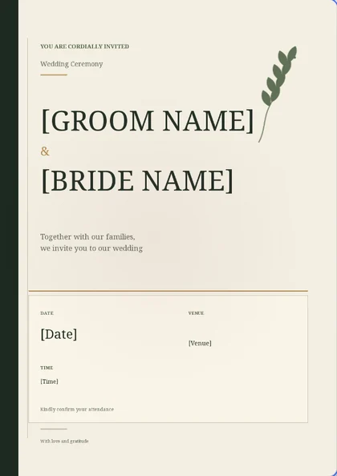 | **The Olive Letter** សិរីមង្គល​អាពាហ៍​ពិពាហ៍ `wd-olive-letter` | Wedding | A5 portrait (1000×1414) | 1 | 14 | 0 | elegant | `minimal-editorial` | `modern-cambodian-luxury` | wedding, english, editorial, garden, olive, minimal, modern, a5 |
| 38 | 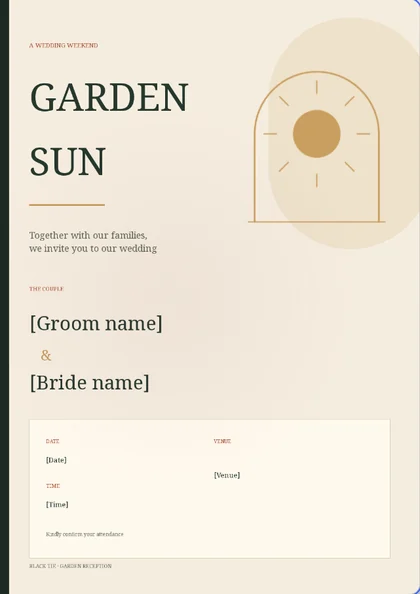 | **Garden Sun** អាពាហ៍ពិពាហ៍ សួនថ្ងៃរះ `en-garden-sun` | Wedding | A5 portrait (1000×1414) | 1 | 16 | 0 | elegant | `floral-reveal` | `botanical-blush` | english, wedding, garden, terracotta, editorial, a5 |
| 39 | 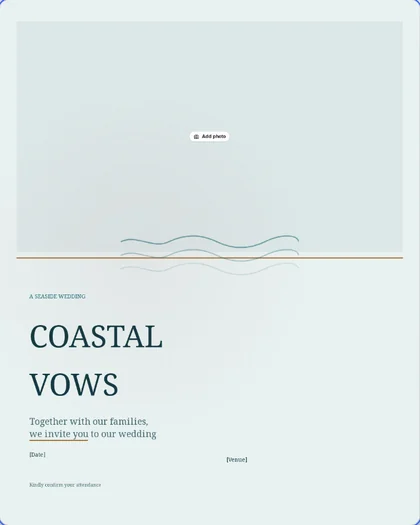 | **Coastal Vows** អាពាហ៍ពិពាហ៍ ឆ្នេរសមុទ្រ `en-coastal-vows` | Wedding | 4:5 portrait (1080×1350) | 1 | 7 | 0 | elegant | `cinematic-photo` | `botanical-blush` | english, wedding, coastal, photo, blue, modern |
| 40 | 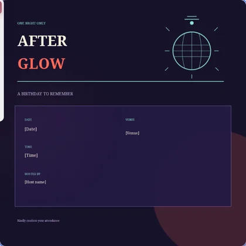 | **Afterglow Disco** ខួបកំណើត រាំពេលយប់ `en-afterglow-disco` | Birthday | Square 1:1 (1080×1080) | 1 | 13 | 0 | festive | `cinematic-photo` | `modern-cambodian-luxury` | english, birthday, disco, neon, party, square |
| 41 | 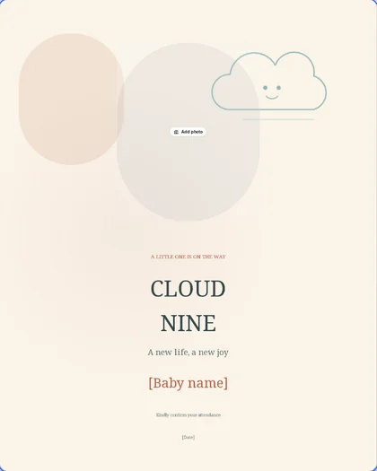 | **Cloud Nine Baby** ស្វាគមន៍កូនថ្មី ពណ៌ទន់ `en-cloud-nine-baby` | Birthday | 4:5 portrait (1080×1350) | 1 | 7 | 0 | elegant | `soft-monogram` | `botanical-blush` | english, baby, shower, pastel, photo, soft |
| 42 | 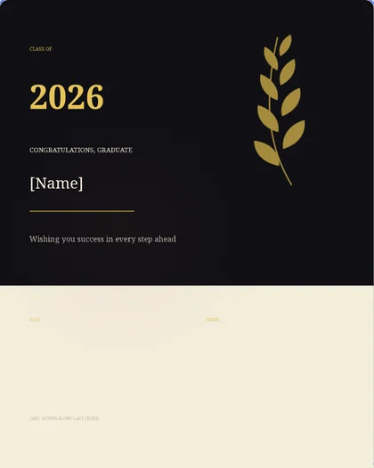 | **Noir Graduate** បញ្ចប់ការសិក្សា ខ្មៅ និងមាស `en-noir-graduate` | Greetings | 4:5 portrait (1080×1350) | 1 | 11 | 0 | modern | `cinematic-photo` | `modern-cambodian-luxury` | english, graduation, noir, gold, modern, portrait |
| 43 | 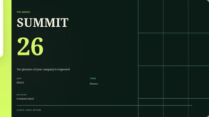 | **Summit 26** សន្និសីទ ឆ្នាំ ២០២៦ `en-summit-26` | Business | Banner 16:9 (1600×900) | 1 | 11 | 0 | modern | `minimal-editorial` | `modern-cambodian-luxury` | english, business, conference, summit, landscape, grid |
| 44 | 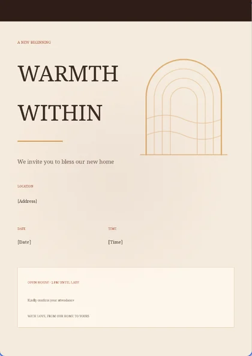 | **Terracotta Home** ឡើងផ្ទះថ្មី ដីឥដ្ឋ `en-terracotta-home` | Ceremony | A5 portrait (1000×1414) | 1 | 13 | 0 | elegant | `minimal-editorial` | `botanical-blush` | english, housewarming, terracotta, arch, warm, a5 |
| 45 | 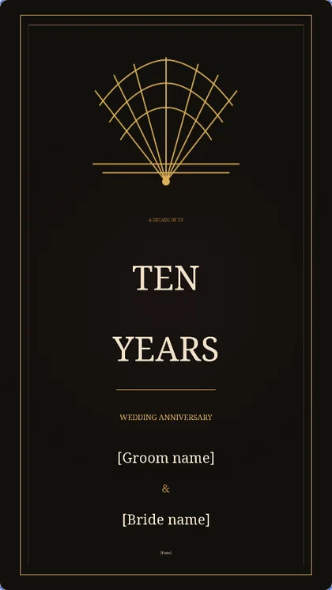 | **Deco Anniversary** ខួបអាពាហ៍ពិពាហ៍ ស្ថាបត្យកម្ម `en-deco-anniversary` | Wedding | Story 9:16 (1080×1920) | 1 | 8 | 0 | ceremonial | `silk-curtain` | `royal-khmer-gold` | english, anniversary, deco, gold, story, formal |
| 46 | 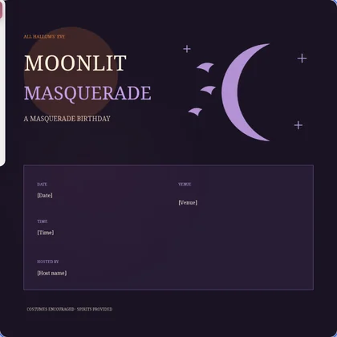 | **Moonlit Halloween** ជប់លៀងហាឡូវីន `en-moonlit-halloween` | Birthday | Square 1:1 (1080×1080) | 1 | 13 | 0 | festive | `cinematic-photo` | `modern-cambodian-luxury` | english, halloween, birthday, masquerade, moon, square |
| 47 | 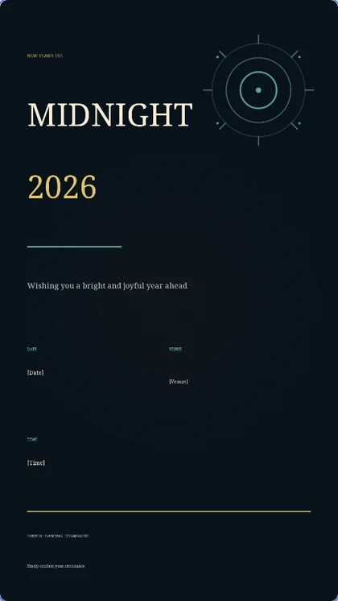 | **Midnight New Year** ឆ្នាំថ្មី ពាក់កណ្តាលអធ្រាត្រ `en-midnight-new-year` | Greetings | Story 9:16 (1080×1920) | 1 | 12 | 0 | elegant | `cinematic-photo` | `modern-cambodian-luxury` | english, new-year, midnight, gold, story, party |
| 48 | 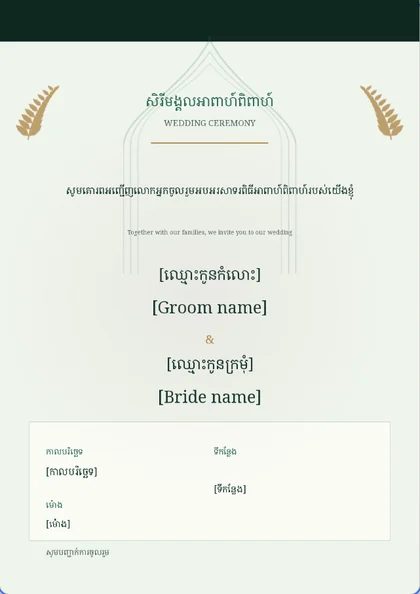 | **Bokor Vows** អាពាហ៍ពិពាហ៍ បូកគោ `km-bokor-vows` | Wedding | A5 portrait (1000×1414) | 1 | 16 | 0 | elegant | `floral-reveal` | `botanical-blush` | khmer, wedding, bokor, green, arch, a5 |
| 49 | 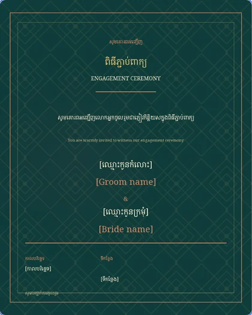 | **Silk Engagement** ពិធីភ្ជាប់ពាក្យ សូត្រខ្មែរ `km-silk-engagement` | Wedding | 4:5 portrait (1080×1350) | 1 | 15 | 0 | ceremonial | `silk-curtain` | `royal-khmer-gold` | khmer, engagement, silk, teal, gold, pattern |
| 50 | 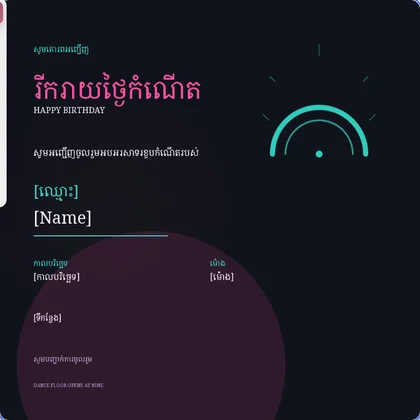 | **Neon Birthday** ខួបកំណើត ពន្លឺពណ៌ `km-neon-birthday` | Birthday | Square 1:1 (1080×1080) | 1 | 13 | 0 | festive | `cinematic-photo` | `modern-cambodian-luxury` | khmer, birthday, neon, pink, square, modern |
| 51 | 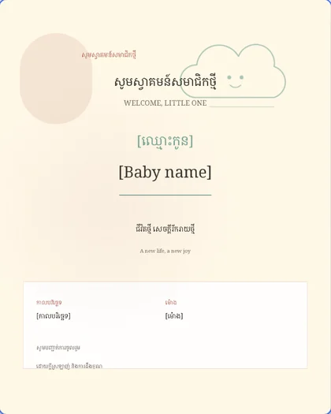 | **Baby Blessing** ពរជ័យកូនថ្មី `km-baby-blessing` | Greetings | 4:5 portrait (1080×1350) | 1 | 13 | 0 | elegant | `soft-monogram` | `botanical-blush` | khmer, baby, blessing, pastel, soft, portrait |
| 52 | 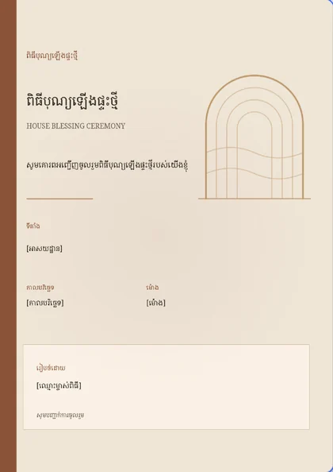 | **Wood & Earth Home** ឡើងផ្ទះថ្មី ឈើ និងដី `km-wood-earth-home` | Ceremony | A5 portrait (1000×1414) | 1 | 13 | 0 | elegant | `minimal-editorial` | `botanical-blush` | khmer, housewarming, wood, earth, arch, a5 |
| 53 | 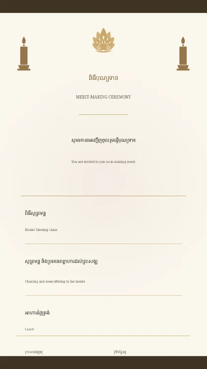 | **Lotus Merit** បុណ្យទាន ផ្កាឈូកស `km-lotus-merit` | Ceremony | Story 9:16 (1080×1920) | 1 | 12 | 0 | ceremonial | `minimal-editorial` | `modern-cambodian-luxury` | khmer, merit, lotus, quiet, story, respectful |
| 54 | 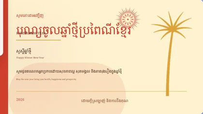 | **Sra Sor New Year** ចូលឆ្នាំថ្មី ស្រស់ស្រាយ `km-sra-sor-new-year` | Greetings | Banner 16:9 (1600×900) | 1 | 9 | 0 | festive | `floral-reveal` | `botanical-blush` | khmer, khmer-new-year, festival, landscape, bright, palm |
| 55 | 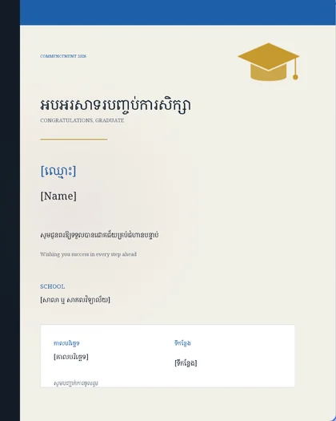 | **Modern Graduate** បញ្ចប់ការសិក្សា ទំនើប `km-modern-graduate` | Greetings | 4:5 portrait (1080×1350) | 1 | 14 | 0 | modern | `minimal-editorial` | `modern-cambodian-luxury` | khmer, graduation, modern, blue, grid, portrait |
| 56 | 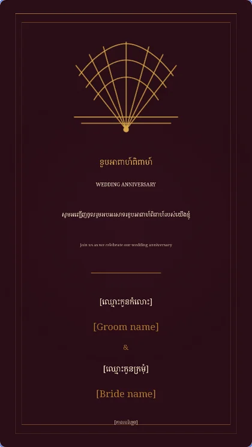 | **Golden Anniversary** ខួបអាពាហ៍ពិពាហ៍ មាសក្រហម `km-golden-anniversary` | Wedding | Story 9:16 (1080×1920) | 1 | 10 | 0 | ceremonial | `silk-curtain` | `royal-khmer-gold` | khmer, anniversary, gold, burgundy, story, formal |
| 57 | 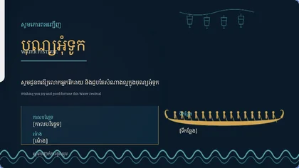 | **River Night** បុណ្យអុំទូក យប់ទន្លេ `km-river-night` | Greetings | Banner 16:9 (1600×900) | 1 | 12 | 0 | festive | `cinematic-photo` | `modern-cambodian-luxury` | khmer, water-festival, night, river, landscape, lanterns |
| 58 | 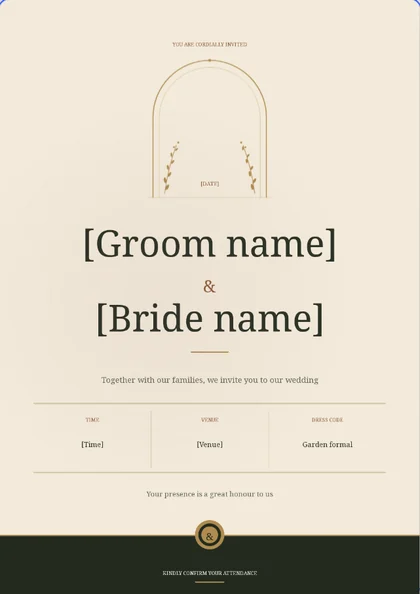 | **Amber Arch** ទ្វារធ្នូមាស `en-amber-arch` | Wedding | A5 portrait (1000×1414) | 1 | 15 | 0 | elegant | `soft-monogram` | `botanical-blush` | english, wedding, arch, olive, brass, letterpress, a5 |
| 59 | 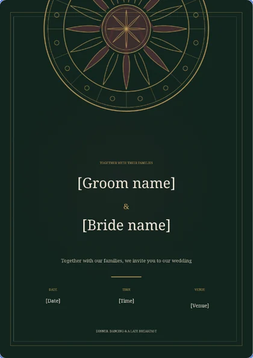 | **Cathedral Rose** មង្គលការផ្កាកុលាប `en-cathedral-rose` | Wedding | A5 portrait (1000×1414) | 1 | 12 | 0 | ceremonial | `silk-curtain` | `royal-khmer-gold` | english, wedding, cathedral, stained-glass, forest, gold, formal, a5 |
| 60 | 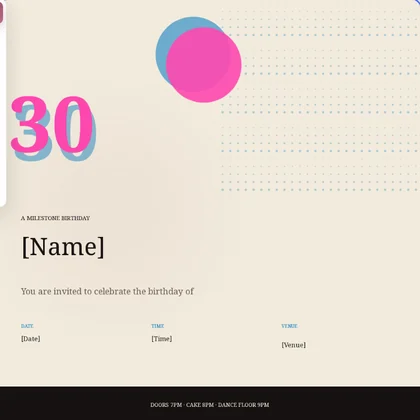 | **Riso Thirty** ខួប​កំណើត​៣០​ឆ្នាំ `en-riso-thirty` | Birthday | Square 1:1 (1080×1080) | 1 | 12 | 0 | festive | `minimal-editorial` | `modern-cambodian-luxury` | english, birthday, milestone, risograph, square, bold |
| 61 | 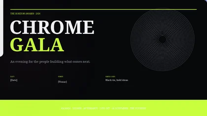 | **Chrome Gala** ពិធី​ប្រគល់​រង្វាន់​ក្រូម `en-chrome-gala` | Business | Banner 16:9 (1600×900) | 1 | 11 | 0 | modern | `cinematic-photo` | `modern-cambodian-luxury` | english, business, awards, gala, chrome, neon, banner |
| 62 | 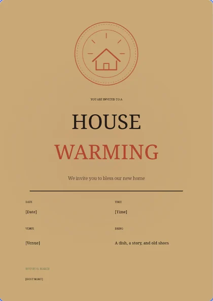 | **Kraft Hearth** ពិធី​ប្រទានពរ​ផ្ទះ​ថ្មី `en-kraft-hearth` | Ceremony | A5 portrait (1000×1414) | 1 | 14 | 0 | elegant | `minimal-editorial` | `botanical-blush` | english, housewarming, kraft, stamp, folk, a5 |
| 63 | 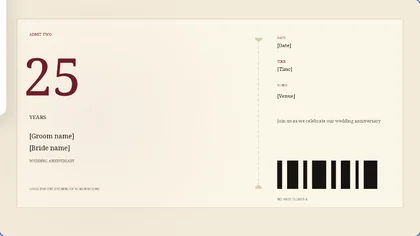 | **Silver Stub** ខួប​អាពាហ៍ពិពាហ៍​២៥​ឆ្នាំ `en-ticket-anniv` | Wedding | Banner 16:9 (1600×900) | 1 | 15 | 0 | elegant | `minimal-editorial` | `modern-cambodian-luxury` | english, anniversary, ticket, editorial, banner, oxblood |
| 64 | 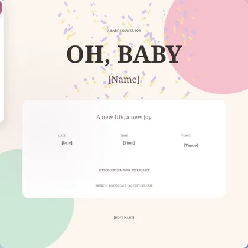 | **Confetti Shower** ពិធី​សែន​ទារក `en-confetti-shower` | Ceremony | Square 1:1 (1080×1080) | 1 | 13 | 0 | festive | `soft-monogram` | `botanical-blush` | english, baby-shower, pastel, confetti, soft, square |
| 65 | 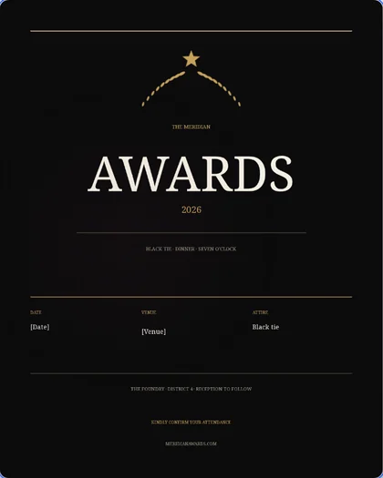 | **Award Noir** ពិធី​រង្វាន់​រាត្រី​ខ្មៅ `en-award-noir` | Business | 4:5 portrait (1080×1350) | 1 | 13 | 0 | ceremonial | `silk-curtain` | `royal-khmer-gold` | english, awards, black-tie, poster, gold, formal |
| 66 | 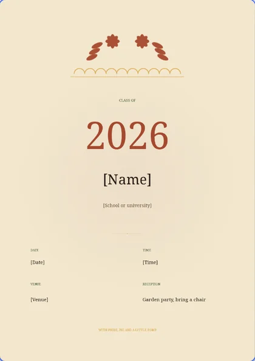 | **Folk Cap** ពិធី​បញ្ចប់​ការសិក្សា `en-folk-grad` | Greetings | A5 portrait (1000×1414) | 1 | 13 | 0 | festive | `floral-reveal` | `botanical-blush` | english, graduation, folk, warm, craft, a5 |
| 67 | 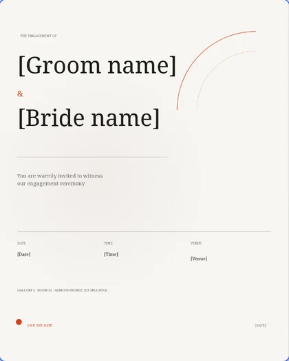 | **Quiet Museum** ពិធី​ភ្ជាប់ពាក្យ​បែប​សារមន្ទីរ `en-museum-engage` | Wedding | 4:5 portrait (1080×1350) | 1 | 14 | 0 | modern | `minimal-editorial` | `modern-cambodian-luxury` | english, engagement, swiss, minimal, museum, editorial |
| 68 | 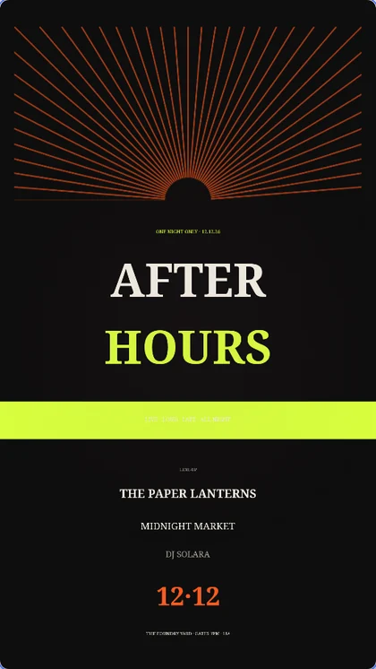 | **After Hours** ពិធីបុណ្យ​តន្ត្រី​ពេលយប់ `en-festival-lineup` | Greetings | Story 9:16 (1080×1920) | 1 | 10 | 0 | festive | `cinematic-photo` | `modern-cambodian-luxury` | english, festival, lineup, bold, night, story |
| 69 | 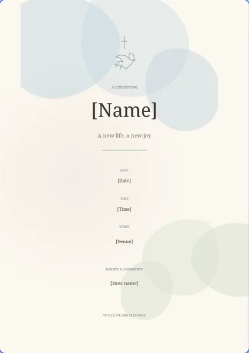 | **Washed in Light** ពិធី​ជ្រមុជទឹក​ទារក `en-watercolour-christen` | Ceremony | A5 portrait (1000×1414) | 1 | 12 | 0 | elegant | `soft-monogram` | `botanical-blush` | english, christening, watercolour, soft, ceremony, a5 |
| 70 | 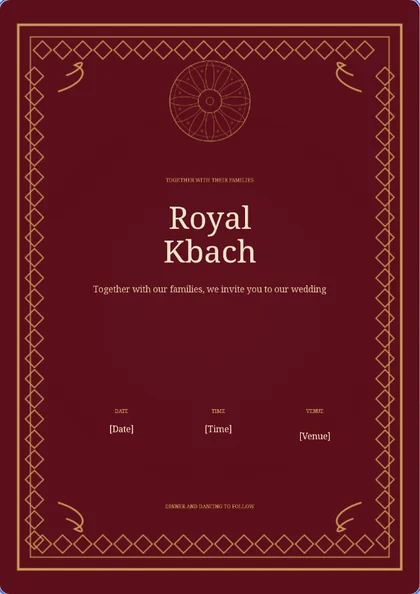 | **Royal Kbach** សិរីមង្គល​អាពាហ៍​ពិពាហ៍ `km-royal-kbach` | Wedding | A5 portrait (1000×1414) | 1 | 11 | 0 | elegant | `silk-curtain` | `royal-khmer-gold` | english, wedding, kbach, gold, royal, a5 |
| 71 | 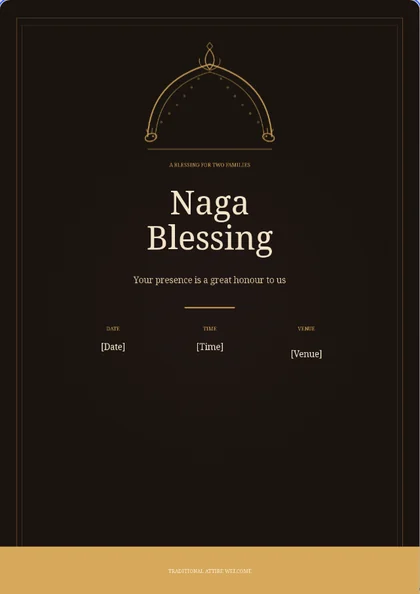 | **Naga Blessing** សិរីមង្គល​អាពាហ៍​ពិពាហ៍ `km-naga-blessing` | Wedding | A5 portrait (1000×1414) | 1 | 11 | 0 | elegant | `silk-curtain` | `royal-khmer-gold` | english, wedding, naga, gold, traditional, a5 |
| 72 | 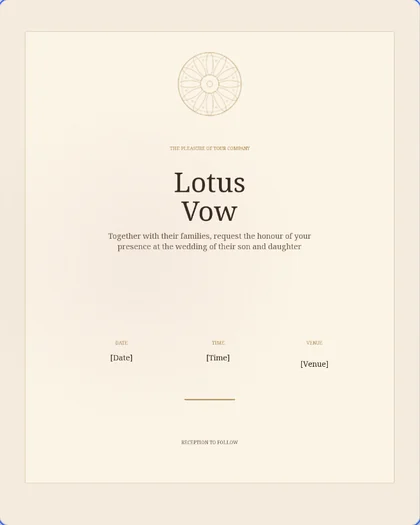 | **Lotus Vow** សិរីមង្គល​អាពាហ៍​ពិពាហ៍ `km-lotus-vow` | Wedding | 4:5 portrait (1080×1350) | 1 | 11 | 0 | elegant | `soft-monogram` | `botanical-blush` | english, wedding, lotus, ivory, serif, p45 |
| 73 | 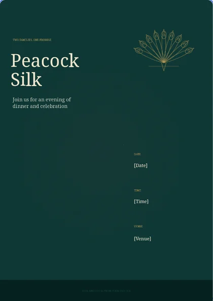 | **Peacock Silk** សិរីមង្គល​អាពាហ៍​ពិពាហ៍ `km-peacock-silk` | Wedding | A5 portrait (1000×1414) | 1 | 11 | 0 | elegant | `silk-curtain` | `royal-khmer-gold` | english, wedding, peacock, silk, teal, a5 |
| 74 | 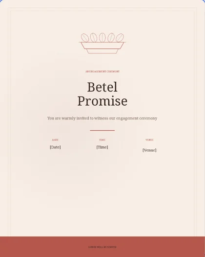 | **Betel Promise** សិរីមង្គល​អាពាហ៍​ពិពាហ៍ `km-betel-promise` | Wedding | 4:5 portrait (1080×1350) | 1 | 11 | 0 | elegant | `floral-reveal` | `botanical-blush` | english, wedding, engagement, betel, blush, p45 |
| 75 | 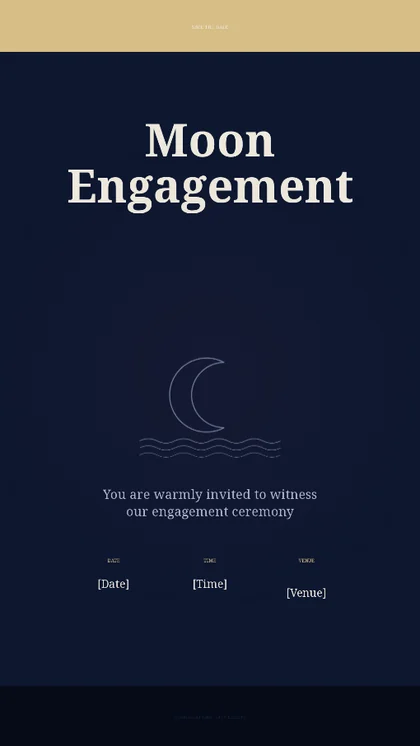 | **Moon Engagement** សិរីមង្គល​អាពាហ៍​ពិពាហ៍ `km-moon-engagement` | Wedding | Story 9:16 (1080×1920) | 1 | 11 | 0 | elegant | `cinematic-photo` | `modern-cambodian-luxury` | english, wedding, engagement, moon, night, story |
| 76 | 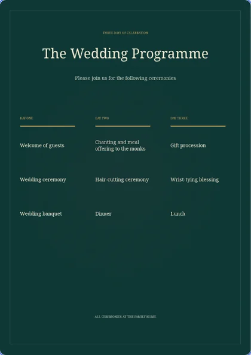 | **Silk Programme** សិរីមង្គល​អាពាហ៍​ពិពាហ៍ `km-silk-programme` | Wedding | A5 portrait (1000×1414) | 1 | 16 | 0 | elegant | `silk-curtain` | `royal-khmer-gold` | english, wedding, programme, three-day, silk, a5 |
| 77 | 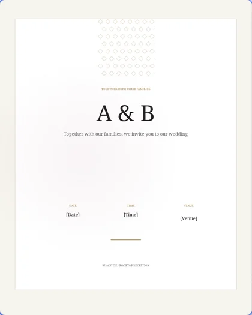 | **Modern Monogram** សិរីមង្គល​អាពាហ៍​ពិពាហ៍ `km-modern-monogram` | Wedding | 4:5 portrait (1080×1350) | 1 | 10 | 0 | elegant | `minimal-editorial` | `modern-cambodian-luxury` | english, wedding, monogram, minimal, modern, p45 |
| 78 | 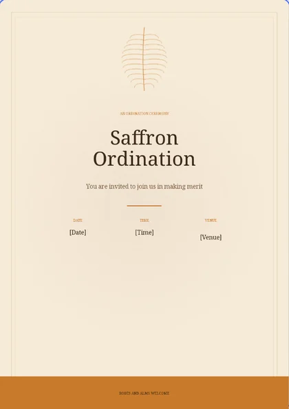 | **Saffron Ordination** សូមជូនពរ `en-ordination-saffron` | Ceremony | A5 portrait (1000×1414) | 1 | 11 | 0 | elegant | `soft-monogram` | `botanical-blush` | english, ceremony, ordination, saffron, temple, a5 |
| 79 | 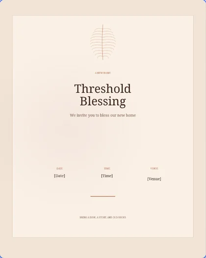 | **Threshold Blessing** សូមជូនពរ `en-house-blessing` | Ceremony | 4:5 portrait (1080×1350) | 1 | 11 | 0 | elegant | `minimal-editorial` | `botanical-blush` | english, ceremony, housewarming, blessing, clay, p45 |
| 80 | 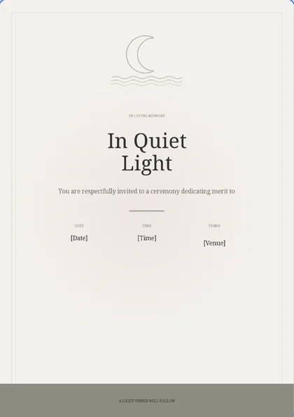 | **In Quiet Light** សូមជូនពរ `en-memorial-light` | Ceremony | A5 portrait (1000×1414) | 1 | 11 | 0 | elegant | `minimal-editorial` | `modern-cambodian-luxury` | english, ceremony, memorial, quiet, ivory, a5 |
| 81 | 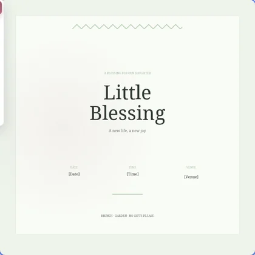 | **Little Blessing** សូមជូនពរ `en-baby-blessing` | Ceremony | Square 1:1 (1080×1080) | 1 | 11 | 0 | elegant | `soft-monogram` | `botanical-blush` | english, ceremony, baby, blessing, pastel, square |
| 82 | 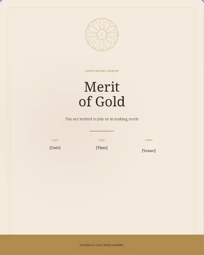 | **Merit of Gold** សូមជូនពរ `en-merit-gold` | Ceremony | 4:5 portrait (1080×1350) | 1 | 11 | 0 | elegant | `silk-curtain` | `royal-khmer-gold` | english, ceremony, merit, gold, temple, p45 |
| 83 | 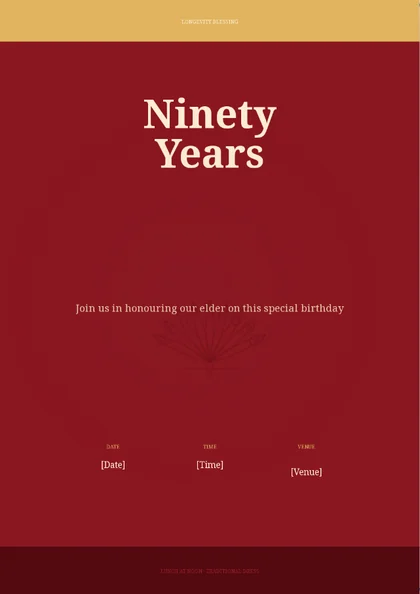 | **Ninety Years** សូមជូនពរ `en-longevity-ninety` | Ceremony | A5 portrait (1000×1414) | 1 | 11 | 0 | elegant | `silk-curtain` | `royal-khmer-gold` | english, ceremony, longevity, elder, red, a5 |
| 84 | 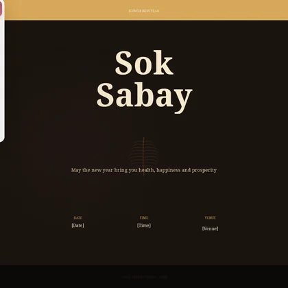 | **Sok Sabay** សូមជូនពរ `en-khmer-new-year` | Greetings | Square 1:1 (1080×1080) | 1 | 11 | 0 | elegant | `floral-reveal` | `botanical-blush` | english, greeting, new-year, khmer, gold, square |
| 85 | 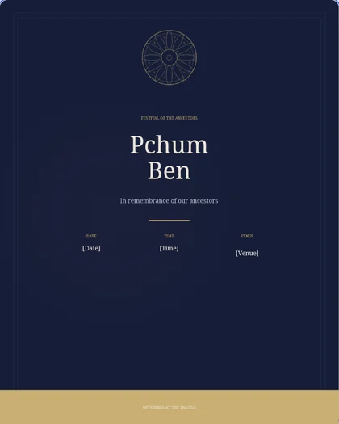 | **Pchum Ben** សូមជូនពរ `en-pchum-ben` | Greetings | 4:5 portrait (1080×1350) | 1 | 11 | 0 | elegant | `silk-curtain` | `royal-khmer-gold` | english, greeting, pchum-ben, ancestors, indigo, p45 |
| 86 | 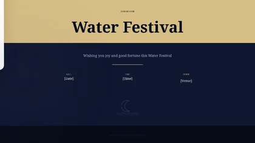 | **Water Festival** សូមជូនពរ `en-water-festival` | Greetings | Banner 16:9 (1600×900) | 1 | 10 | 0 | elegant | `cinematic-photo` | `modern-cambodian-luxury` | english, greeting, water-festival, boat, night, banner |
| 87 |  | **Kathina Offering** សូមជូនពរ `en-kathina` | Greetings | A5 portrait (1000×1414) | 1 | 11 | 0 | elegant | `soft-monogram` | `botanical-blush` | english, greeting, kathina, merit, saffron, a5 |
| 88 |  | **Vesak Moon** សូមជូនពរ `en-vesak-moon` | Greetings | 4:5 portrait (1080×1350) | 1 | 11 | 0 | elegant | `minimal-editorial` | `modern-cambodian-luxury` | english, greeting, vesak, moon, indigo, p45 |
| 89 |  | **For Her** សូមជូនពរ `en-womens-day` | Greetings | Square 1:1 (1080×1080) | 1 | 11 | 0 | elegant | `cinematic-photo` | `modern-cambodian-luxury` | english, greeting, women, coral, bold, square |
| 90 |  | **Gold Night** សូមជូនពរ `en-christmas-gold` | Greetings | 4:5 portrait (1080×1350) | 1 | 11 | 0 | elegant | `silk-curtain` | `royal-khmer-gold` | english, greeting, christmas, gold, pine, p45 |
| 91 |  | **With Thanks** សូមជូនពរ `en-with-thanks` | Greetings | Square 1:1 (1080×1080) | 1 | 11 | 0 | elegant | `soft-monogram` | `botanical-blush` | english, greeting, thank-you, ivory, quiet, square |
| 92 |  | **One Year** ពិធី​អបអរសាទរ​ខួបកំណើត `en-first-birthday` | Birthday | Square 1:1 (1080×1080) | 1 | 11 | 0 | elegant | `floral-reveal` | `botanical-blush` | english, birthday, first, pastel, square |
| 93 |  | **Sixteen** ពិធី​អបអរសាទរ​ខួបកំណើត `en-sweet-sixteen` | Birthday | Story 9:16 (1080×1920) | 1 | 11 | 0 | elegant | `cinematic-photo` | `modern-cambodian-luxury` | english, birthday, sixteen, neon, story |
| 94 |  | **Sixty Years** ពិធី​អបអរសាទរ​ខួបកំណើត `en-sixty-years` | Birthday | A5 portrait (1000×1414) | 1 | 11 | 0 | elegant | `silk-curtain` | `royal-khmer-gold` | english, birthday, sixty, red, gold, a5 |
| 95 |  | **Carnival Day** ពិធី​អបអរសាទរ​ខួបកំណើត `en-carnival-day` | Birthday | Banner 16:9 (1600×900) | 1 | 10 | 0 | elegant | `floral-reveal` | `botanical-blush` | english, birthday, kids, carnival, banner |
| 96 |  | **Thirty, Golden** ពិធី​អបអរសាទរ​ខួបកំណើត `en-thirty-gold` | Birthday | Square 1:1 (1080×1080) | 1 | 11 | 0 | elegant | `cinematic-photo` | `modern-cambodian-luxury` | english, birthday, thirty, gold, square |
| 97 |  | **Foundry Opening** ពិធីជប់លៀង​អាហារ​ពេលល្ងាច​ប្រចាំឆ្នាំ `en-foundry-opening` | Business | Banner 16:9 (1600×900) | 1 | 10 | 0 | elegant | `cinematic-photo` | `modern-cambodian-luxury` | english, business, opening, lime, banner |
| 98 |  | **Annual Gala** ពិធីជប់លៀង​អាហារ​ពេលល្ងាច​ប្រចាំឆ្នាំ `en-annual-gala` | Business | 4:5 portrait (1080×1350) | 1 | 11 | 0 | elegant | `silk-curtain` | `royal-khmer-gold` | english, business, gala, navy, gold, p45 |
| 99 |  | **Summit 2027** ពិធីជប់លៀង​អាហារ​ពេលល្ងាច​ប្រចាំឆ្នាំ `en-summit-2027` | Business | Banner 16:9 (1600×900) | 1 | 11 | 0 | elegant | `minimal-editorial` | `modern-cambodian-luxury` | english, business, conference, summit, banner |
| 100 |  | **Launch Noir** ពិធីជប់លៀង​អាហារ​ពេលល្ងាច​ប្រចាំឆ្នាំ `en-launch-noir` | Business | Story 9:16 (1080×1920) | 1 | 11 | 0 | elegant | `cinematic-photo` | `modern-cambodian-luxury` | english, business, launch, noir, story |

## Categories

| Category | Templates | Picker filter |
|---|---|---|
| Wedding | 34 | Wedding |
| Birthday | 15 | Birthday |
| Ceremony | 17 | Ceremony |
| Greetings | 25 | Greetings |
| Business | 9 | Business |

## Intended event

Each template is a complete invitation: page 1 is the formal invitation (title, invitation sentence, names, date, time, venue); later pages carry the programme, the venue and the RSVP/wishes copy. 46 designs use Khmer copy with an English companion line; 54 are English-led. Names, dates, times and venue are bracketed placeholders that the editor binds to invitation fields.

## Ornaments

The pack draws on 64 original SVG ornaments (`assets/template-pack/ornaments/`), served with a content hash and cache headers. Each built template references one to eight of them; none is a third-party image. See [`docs/ASSETS.md`](../ASSETS.md) for the SHA-256 of every file.
