# Khmer event template pack — catalogue

The 36 pack templates, served from `/assets/template-pack/` and listed by the
Template Studio under **Khmer events**. Every entry is a native invitation
document (`schemaVersion` 1) built by `tools/build-template-pack.py` from
`template-pack/`; the picker never imports the pack into the editor bundle.

- Source of truth: `template-pack/catalog.json` (copy, palettes, pages) and the
  per-template layer files under `template-pack/templates/`.
- Rebuild: `.venv/bin/python tools/build-template-pack.py`
- Verify: `.venv/bin/python tools/build-template-pack.py --check` and
  `.venv/bin/python -m pytest tests/test_template_pack.py -q`
- Thumbnails: `assets/template-pack/thumbs/<id>.webp`, 420 px wide, rendered in
  the real editor by `tools/render-template-thumbs.py`.
- Acceptance evidence: [ACCEPTANCE-2026-10-25.md](ACCEPTANCE-2026-10-25.md),
  [DESIGN-REVIEW-2026-10-25.md](DESIGN-REVIEW-2026-10-25.md),
  [PUBLIC-PROOF-2026-10-25.md](PUBLIC-PROOF-2026-10-25.md) and the
  [final report](FINAL-REPORT-2026-10-25.md).

Canvas codes: `a5p` = A5 portrait 1000×1414; `story` = 1080×1920 story;
`square` = 1080×1080; `portrait` = 1080×1350; `a4p` = A4 portrait 1240×1754.

## The 36

| # | Thumbnail | Template | Category | Canvas | Pages | Text objects | Ornaments | Typography | Opening scene | Style kit | Tags |
|---|---|---|---|---|---|---|---|---|---|---|---|
| 1 | 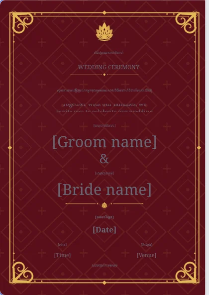 | **Royal Maroon & Gold** អាពាហ៍ពិពាហ៍ ក្រហមមាស `wd-royal-maroon-gold` | Wedding | A5 portrait (1000×1414) | 2 | 34 | 7 | ceremonial | `silk-curtain` | `royal-khmer-gold` | wedding, traditional, royal, dark, gold |
| 2 | 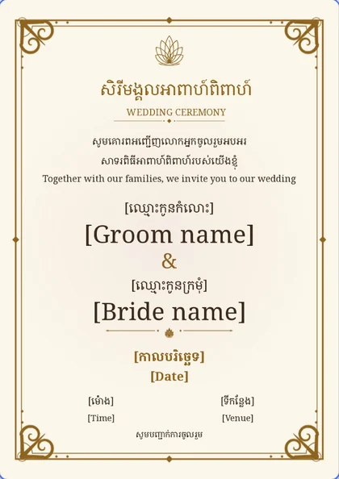 | **Ivory Kbach Frame** អាពាហ៍ពិពាហ៍ ស៊ុមក្បាច់ខ្មែរ `wd-ivory-kbach-frame` | Wedding | A5 portrait (1000×1414) | 1 | 16 | 5 | ceremonial | `silk-curtain` | `royal-khmer-gold` | wedding, traditional, light, gold |
| 3 | 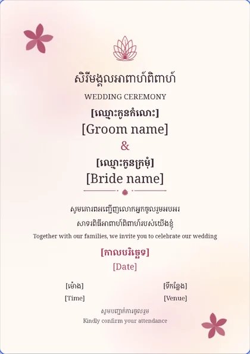 | **Lotus Watercolour** អាពាហ៍ពិពាហ៍ ផ្កាឈូកទន់ភ្លន់ `wd-lotus-watercolour` | Wedding | A5 portrait (1000×1414) | 1 | 17 | 4 | elegant | `floral-reveal` | `botanical-blush` | wedding, soft, pink, watercolour, light |
| 4 | 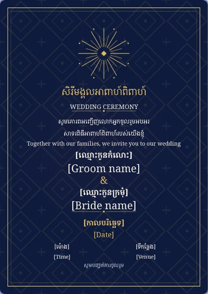 | **Midnight Navy & Gold** អាពាហ៍ពិពាហ៍ ខៀវយប់ និងមាស `wd-midnight-navy-gold` | Wedding | A5 portrait (1000×1414) | 1 | 16 | 3 | elegant | `silk-curtain` | `royal-khmer-gold` | wedding, modern, dark, gold, navy |
| 5 | 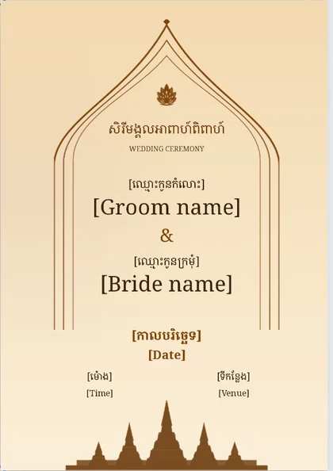 | **Temple Arch** អាពាហ៍ពិពាហ៍ ក្លោងទ្វារប្រាសាទ `wd-temple-arch` | Wedding | A5 portrait (1000×1414) | 1 | 13 | 3 | ceremonial | `silk-curtain` | `royal-khmer-gold` | wedding, traditional, temple, angkor, warm |
| 6 | 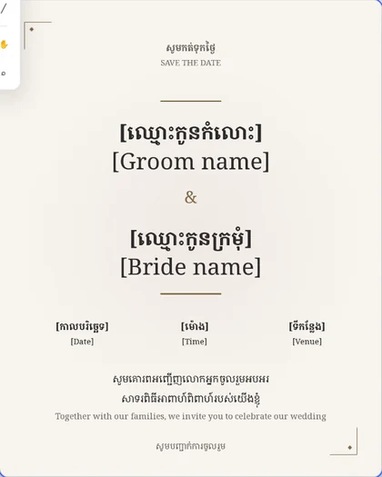 | **Quiet Ivory** អាពាហ៍ពិពាហ៍ ស្អាតសាមញ្ញ `wd-quiet-ivory` | Wedding | 4:5 portrait (1080×1350) | 1 | 16 | 1 | modern | `soft-monogram` | `botanical-blush` | wedding, minimal, modern, light |
| 7 | 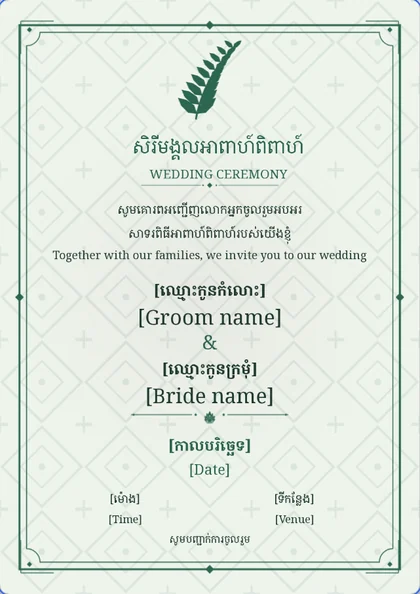 | **Jade Garden** អាពាហ៍ពិពាហ៍ សួនបៃតង `wd-jade-garden` | Wedding | A5 portrait (1000×1414) | 1 | 16 | 6 | elegant | `floral-reveal` | `botanical-blush` | wedding, green, garden, light, elegant |
| 8 | 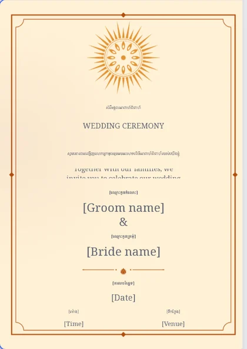 | **Saffron Sunrise** អាពាហ៍ពិពាហ៍ ថ្ងៃរះ `wd-saffron-sunrise` | Wedding | A5 portrait (1000×1414) | 1 | 15 | 3 | elegant | `floral-reveal` | `botanical-blush` | wedding, warm, sunrise, orange, traditional |
| 9 | 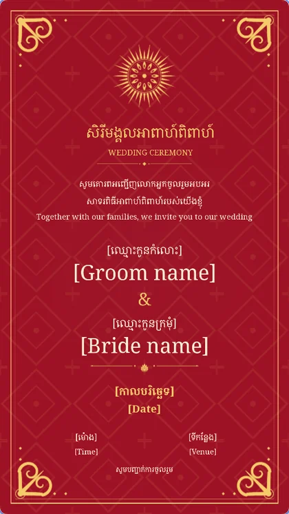 | **Red & Gold Story** អាពាហ៍ពិពាហ៍ ក្រហម និងមាស `wd-red-gold-story` | Wedding | Story 9:16 (1080×1920) | 1 | 16 | 5 | ceremonial | `silk-curtain` | `royal-khmer-gold` | wedding, red, gold, story, phone, traditional |
| 10 | 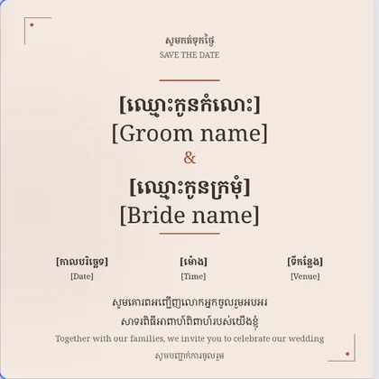 | **Save the Date** កត់ទុកថ្ងៃ ផ្កាឈូកខ្ចី `wd-save-the-date` | Wedding | Square 1:1 (1080×1080) | 1 | 16 | 1 | modern | `soft-monogram` | `botanical-blush` | wedding, save-the-date, minimal, engagement, square |
| 11 | 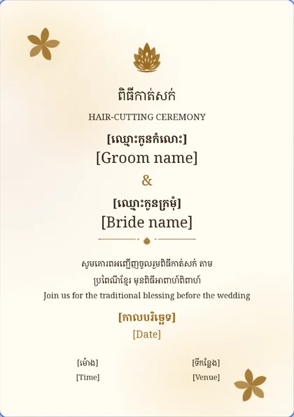 | **Hair-Cutting Blessing** កាត់សក់ ផ្កាឈូកទន់ភ្លន់ `wd-hair-cutting` | Wedding | A5 portrait (1000×1414) | 1 | 15 | 4 | elegant | `floral-reveal` | `botanical-blush` | wedding, hair-cutting, ceremony, gold, soft |
| 12 | 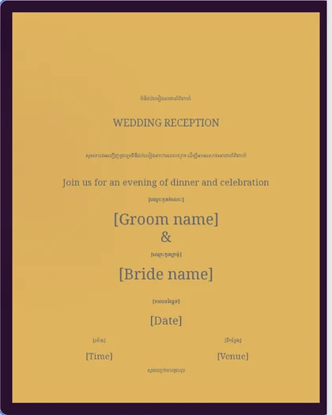 | **Dark Plum Reception** ជប់លៀង ខ្មៅស្វាយ និងមាស `wd-reception-dark-plum` | Wedding | 4:5 portrait (1080×1350) | 1 | 16 | 2 | elegant | `silk-curtain` | `royal-khmer-gold` | wedding, reception, dark, gold, evening |
| 13 | 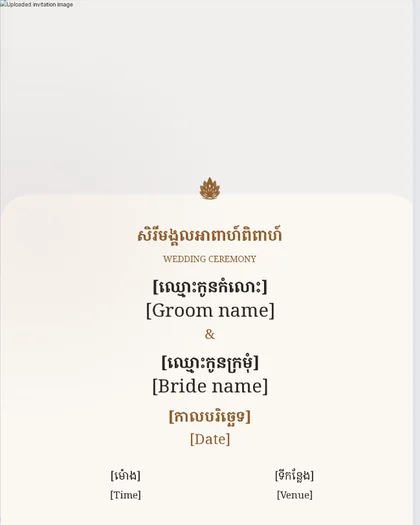 | **Photo Modern** អាពាហ៍ពិពាហ៍ ទំនើប `wd-photo-modern` | Wedding | 4:5 portrait (1080×1350) | 1 | 13 | 1 | modern | `floral-reveal` | `botanical-blush` | wedding, photo, modern, light |
| 14 | 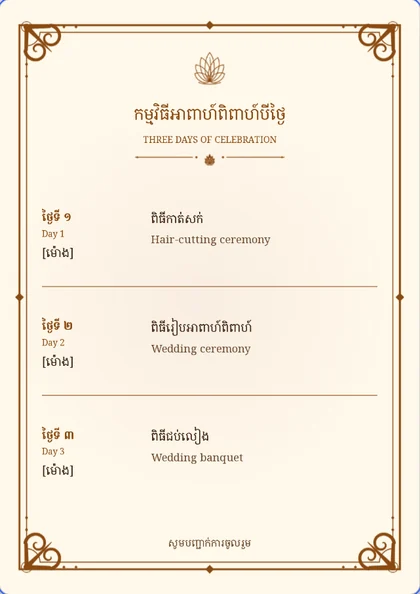 | **Three-Day Programme** កម្មវិធីបីថ្ងៃ បែបប្រពៃណី `wd-three-day-program` | Wedding | A5 portrait (1000×1414) | 1 | 18 | 4 | ceremonial | `soft-monogram` | `botanical-blush` | wedding, programme, schedule, traditional |
| 15 | 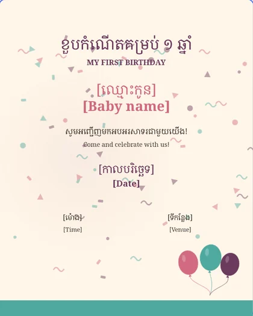 | **First Birthday Pastel** ខួបកំណើតគម្រប់ ១ ឆ្នាំ ពណ៌ទន់ `bd-first-pastel` | Birthday | 4:5 portrait (1080×1350) | 1 | 12 | 2 | festive | `floral-reveal` | `botanical-blush` | birthday, first, kids, pastel |
| 16 | 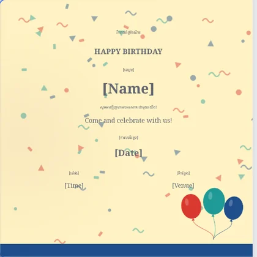 | **Kids Party** ជប់លៀងកុមារ ពណ៌ដិតដាស់ `bd-kids-party` | Birthday | Square 1:1 (1080×1080) | 1 | 12 | 2 | festive | `floral-reveal` | `botanical-blush` | birthday, kids, party, bold |
| 17 | 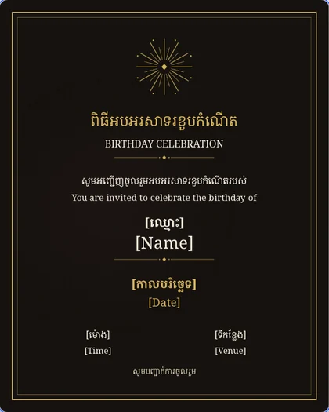 | **Golden Soirée** ខួបកំណើត ខ្មៅ និងមាស `bd-golden-soiree` | Birthday | 4:5 portrait (1080×1350) | 1 | 13 | 2 | elegant | `cinematic-photo` | `modern-cambodian-luxury` | birthday, adult, dark, gold, elegant |
| 18 | 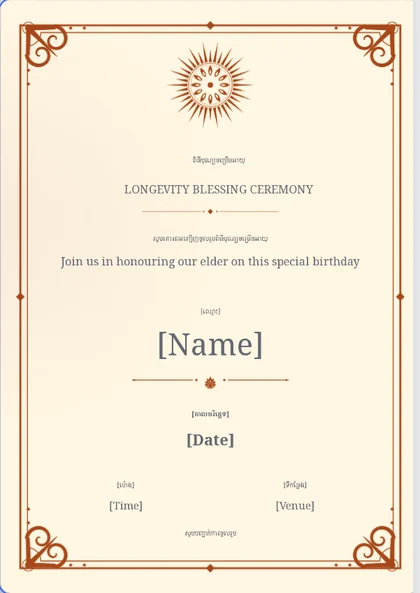 | **Longevity Blessing** ចម្រើនអាយុ មាសព្រះអាទិត្យ `bd-longevity-60` | Birthday | A5 portrait (1000×1414) | 1 | 13 | 5 | ceremonial | `minimal-editorial` | `modern-cambodian-luxury` | birthday, longevity, elder, respectful, traditional |
| 19 | 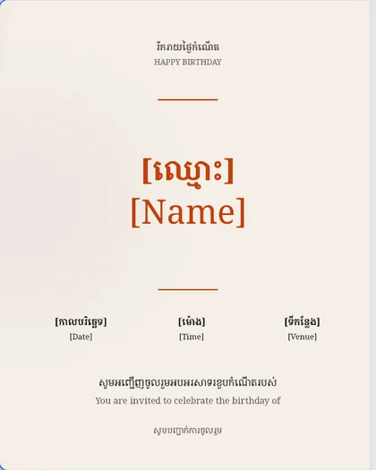 | **Modern Bold** ខួបកំណើត ពណ៌ដិតដាស់ `bd-modern-bold` | Birthday | 4:5 portrait (1080×1350) | 1 | 13 | 0 | modern | `cinematic-photo` | `modern-cambodian-luxury` | birthday, modern, minimal, adult |
| 20 | 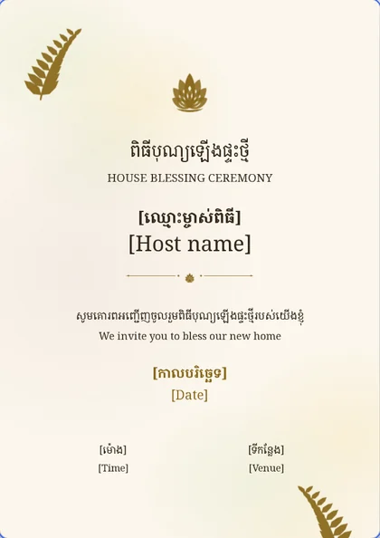 | **House Blessing** ឡើងផ្ទះថ្មី ផ្កាឈូកទន់ភ្លន់ `hw-housewarming` | Ceremony | A5 portrait (1000×1414) | 1 | 12 | 4 | elegant | `minimal-editorial` | `modern-cambodian-luxury` | housewarming, blessing, ceremony, warm |
| 21 | 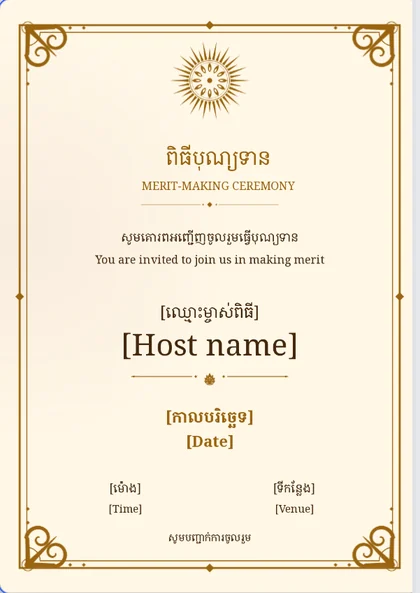 | **Merit-Making** បុណ្យទាន បែបប្រពៃណី `merit-dana` | Ceremony | A5 portrait (1000×1414) | 1 | 13 | 5 | ceremonial | `minimal-editorial` | `modern-cambodian-luxury` | merit, dana, buddhist, respectful, traditional |
| 22 | 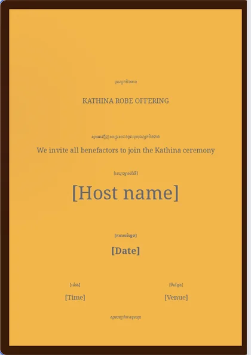 | **Kathina Robe Offering** កឋិនទាន ពណ៌ទឹកក្រូច `kathina-robe` | Ceremony | A5 portrait (1000×1414) | 1 | 13 | 2 | ceremonial | `minimal-editorial` | `modern-cambodian-luxury` | kathina, buddhist, saffron, dark, respectful |
| 23 | 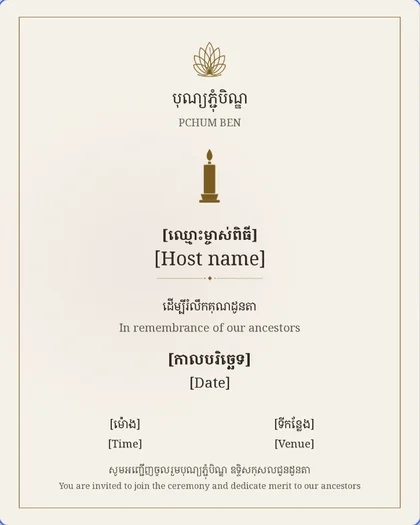 | **Pchum Ben** ភ្ជុំបិណ្ឌ បែបប្រពៃណី `pchum-ben` | Ceremony | 4:5 portrait (1080×1350) | 1 | 14 | 3 | elegant | `minimal-editorial` | `modern-cambodian-luxury` | pchum-ben, ancestors, buddhist, sober, respectful |
| 24 | 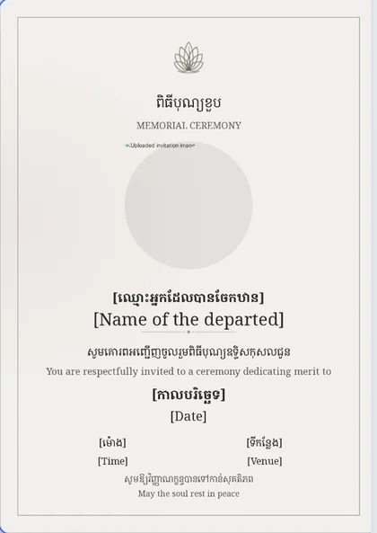 | **Memorial Ceremony** បុណ្យខួប ស្ងប់ស្ងាត់ `memorial-ceremony` | Ceremony | A5 portrait (1000×1414) | 1 | 14 | 2 | elegant | `minimal-editorial` | `modern-cambodian-luxury` | memorial, sober, respectful, monochrome |
| 25 | 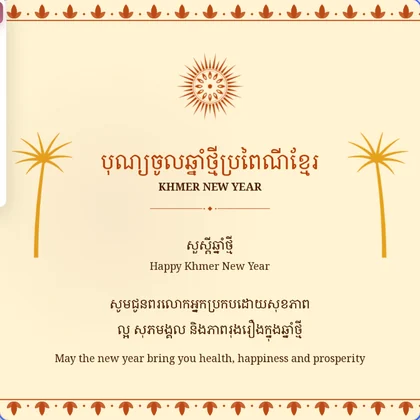 | **Khmer New Year** ចូលឆ្នាំថ្មី ភ្លឺថ្លា `gr-khmer-new-year` | Greetings | Square 1:1 (1080×1080) | 1 | 6 | 4 | festive | `floral-reveal` | `botanical-blush` | greeting, khmer-new-year, festive, warm |
| 26 | 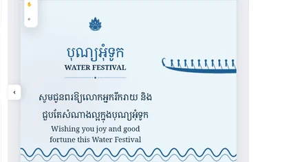 | **Water Festival** បុណ្យអុំទូក ទន្លេខៀវ `gr-water-festival` | Greetings | Banner 16:9 (1600×900) | 1 | 4 | 4 | festive | `floral-reveal` | `botanical-blush` | greeting, water-festival, festive, blue, landscape |
| 27 | 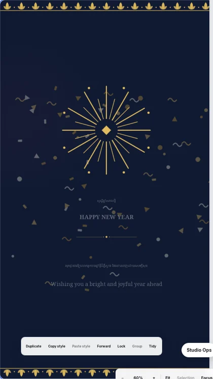 | **Global New Year** ឆ្នាំសកល ខៀវចាស់ និងមាស `gr-global-new-year` | Greetings | Story 9:16 (1080×1920) | 1 | 4 | 4 | festive | `cinematic-photo` | `modern-cambodian-luxury` | greeting, new-year, story, dark, gold |
| 28 | 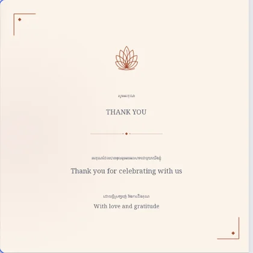 | **Thank You** សូមអរគុណ បែបប្រពៃណី `gr-thank-you` | Greetings | Square 1:1 (1080×1080) | 1 | 6 | 3 | elegant | `minimal-editorial` | `modern-cambodian-luxury` | greeting, thank-you, elegant, warm |
| 29 | 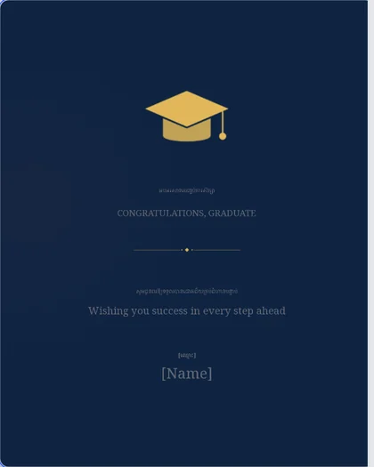 | **Graduation** បញ្ចប់ការសិក្សា ខៀវចាស់ និងមាស `gr-graduation` | Greetings | 4:5 portrait (1080×1350) | 1 | 6 | 2 | elegant | `cinematic-photo` | `modern-cambodian-luxury` | greeting, graduation, congratulations, navy, gold |
| 30 | 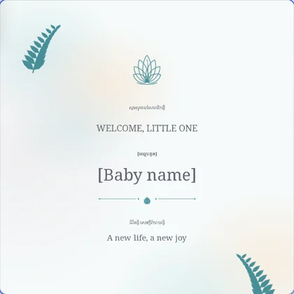 | **Newborn Welcome** កូនកើតថ្មី ពណ៌ទន់ `gr-newborn` | Greetings | Square 1:1 (1080×1080) | 1 | 6 | 4 | elegant | `soft-monogram` | `botanical-blush` | greeting, newborn, baby, pastel, soft |
| 31 | 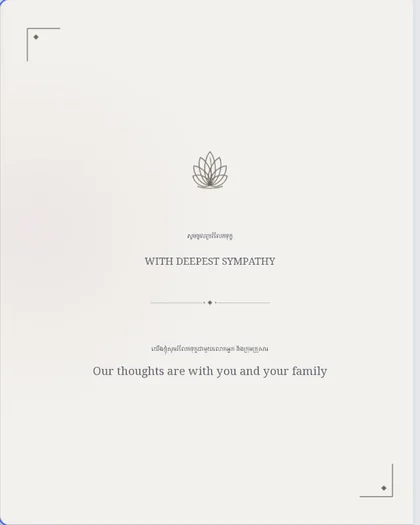 | **With Sympathy** រំលែកទុក្ខ ស្ងប់ស្ងាត់ `gr-sympathy` | Greetings | 4:5 portrait (1080×1350) | 1 | 4 | 3 | elegant | `minimal-editorial` | `modern-cambodian-luxury` | greeting, sympathy, sober, respectful, monochrome |
| 32 | 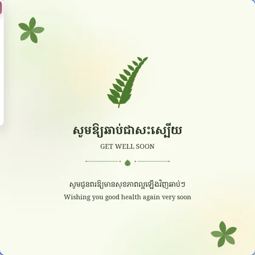 | **Get Well Soon** ឆាប់ជាសះស្បើយ បៃតងខ្ចី `gr-get-well` | Greetings | Square 1:1 (1080×1080) | 1 | 4 | 4 | modern | `minimal-editorial` | `modern-cambodian-luxury` | greeting, get-well, green, soft |
| 33 | 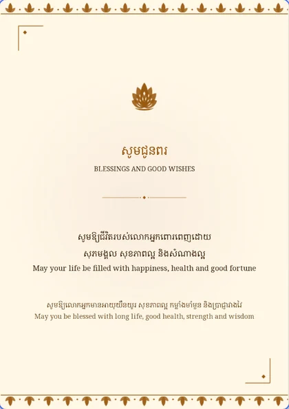 | **Blessings & Good Wishes** ជូនពរ បែបប្រពៃណី `gr-blessings` | Greetings | A5 portrait (1000×1414) | 1 | 6 | 4 | ceremonial | `minimal-editorial` | `modern-cambodian-luxury` | greeting, blessing, respectful, elder, gold |
| 34 | 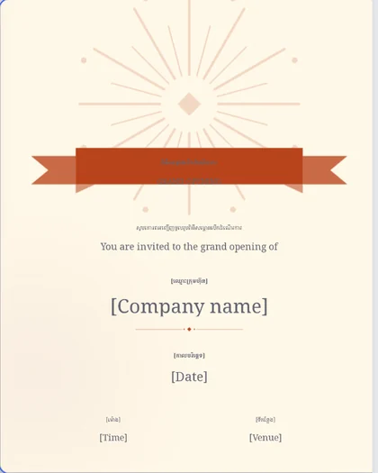 | **Grand Opening** សម្ពោធ ខ្សែបូ `biz-grand-opening` | Business | 4:5 portrait (1080×1350) | 1 | 12 | 3 | modern | `cinematic-photo` | `modern-cambodian-luxury` | business, opening, ribbon, bright |
| 35 | 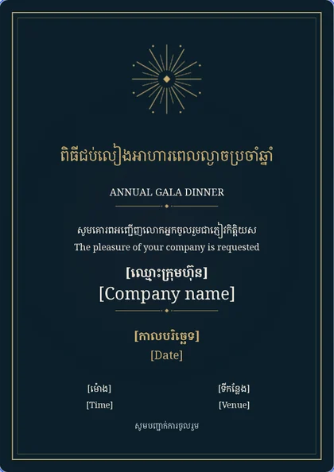 | **Corporate Gala** ជប់លៀងប្រចាំឆ្នាំ ព្រលប់ `biz-corporate-gala` | Business | A5 portrait (1000×1414) | 1 | 13 | 2 | elegant | `cinematic-photo` | `modern-cambodian-luxury` | business, gala, corporate, dark, gold |
| 36 | 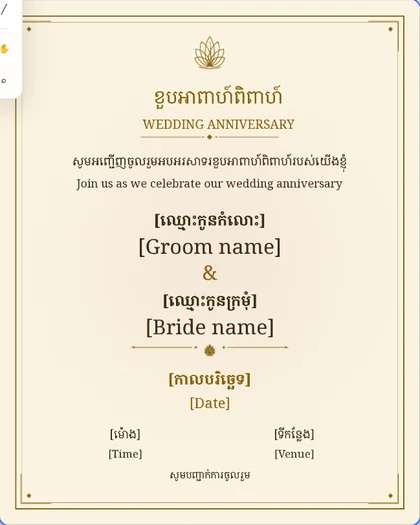 | **Wedding Anniversary** ខួបអាពាហ៍ពិពាហ៍ មាសផ្កាឈូក `anniv-golden` | Wedding | 4:5 portrait (1080×1350) | 1 | 16 | 4 | elegant | `soft-monogram` | `botanical-blush` | anniversary, wedding, gold, elegant |

## Categories

| Category | Templates | Picker filter |
|---|---|---|
| Wedding | 15 | Wedding |
| Birthday | 5 | Birthday |
| Ceremony (housewarming, merit, Kathina, Pchum Ben, memorial) | 5 | Ceremony |
| Greetings | 9 | Greetings |
| Business | 2 | Business |

## Intended event

Each template is a complete multi-page invitation: page 1 is the formal
invitation (title, invitation sentence, names, date, time, venue); later pages
carry the programme, the venue and the RSVP/wishes copy. All copy is Khmer with
an English companion line; names, dates, times and venue are bracketed
placeholders that the editor binds to invitation fields.

## Ornaments

The pack draws on 27 procedural SVG ornaments (`assets/template-pack/ornaments/`),
served with a content hash and cache headers. Each built template references
between four and eight of them; none is a third-party image. See
[`docs/ASSETS.md`](../ASSETS.md) for the SHA-256 of every file.
